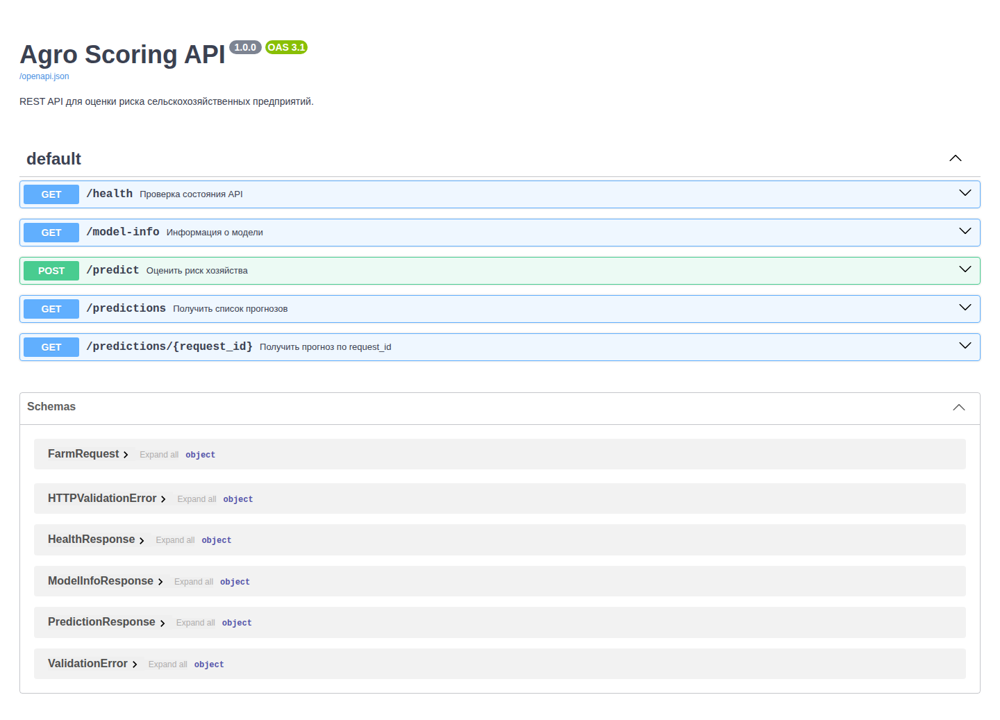
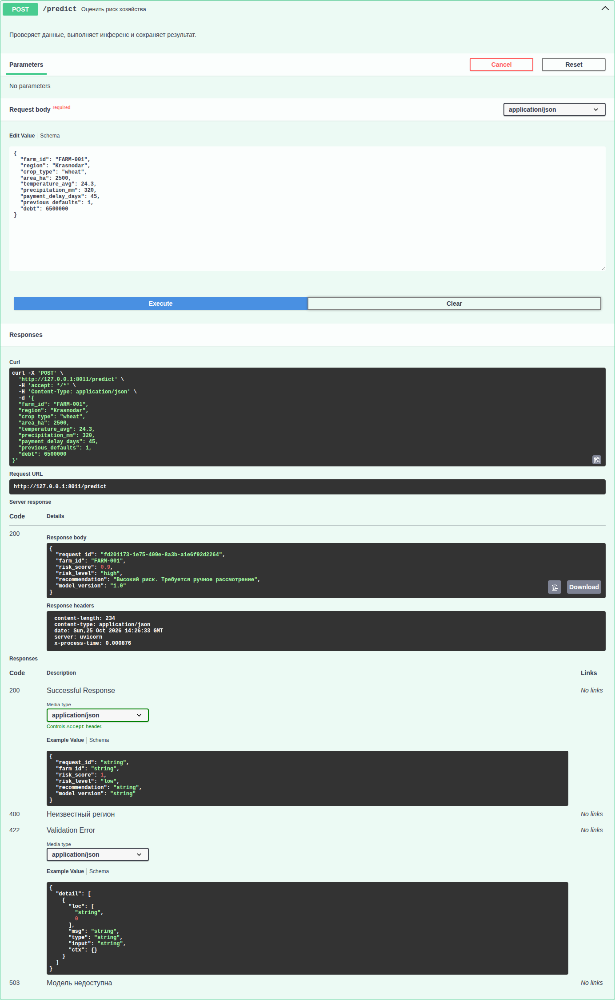
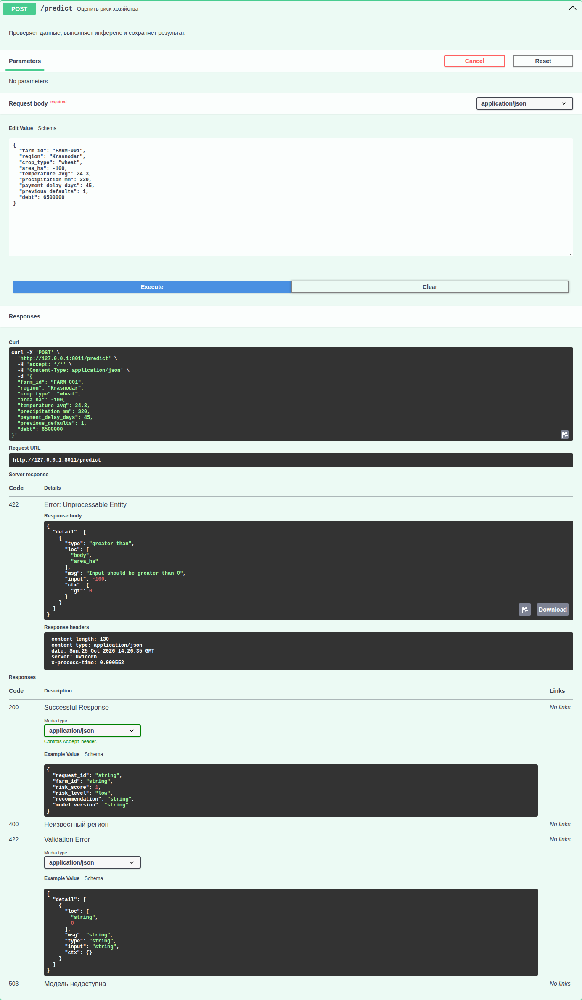
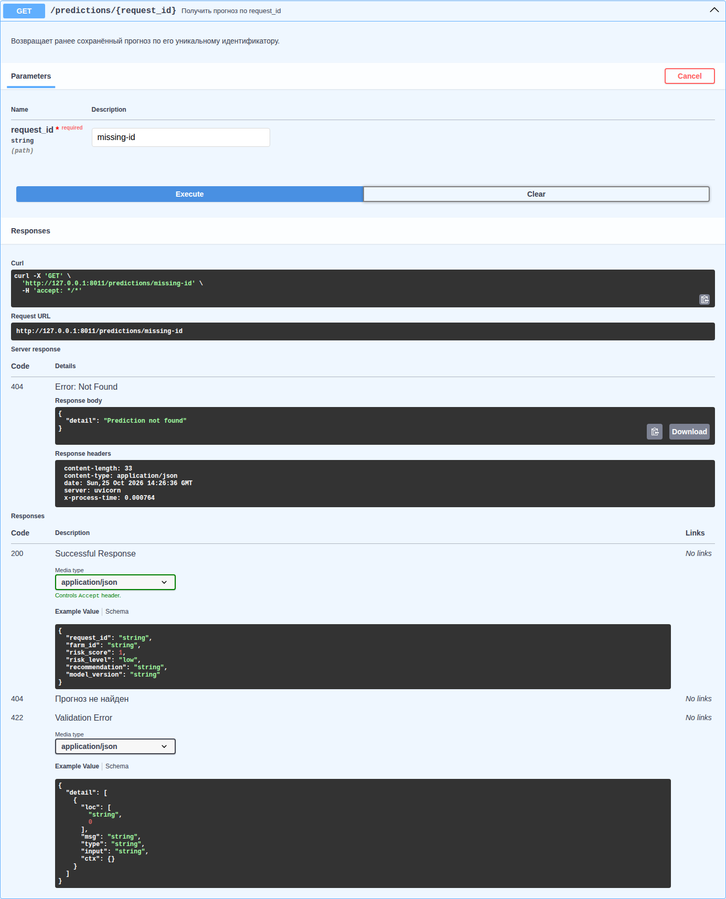

# Отчёт по лабораторной работе №1

**Дисциплина:** «Современные интеллектуальные сетевые сервисы»  
**Тема:** «Проектирование AI-сервиса на FastAPI»  
**Выполнил:** студент группы МПИ-25-1-1 Цыканов Артём Эдуардович  
**Проверила:** Корнет Мария Евгеньевна

## 1. Цель работы

Изучить принципы проектирования REST API для AI-сервиса, реализовать контур инференса на FastAPI, описать контракт при помощи Pydantic/OpenAPI и проверить корректную обработку запросов и ошибок.

## 2. Архитектура

Сервис работает синхронно: клиент отправляет JSON и получает оценку риска в рамках одного HTTP-запроса. Pydantic проверяет структуру данных, сервисный слой — бизнес-ограничения, условная ML-модель рассчитывает score, а постобработка формирует категорию и рекомендацию. Результат сохраняется в оперативной памяти.

Приложение разделено на HTTP-слой (`main.py`), схемы (`schemas.py`), модель (`model.py`), бизнес-логику (`services.py`) и хранилище (`storage.py`). Исходный код решения: [репозиторий на GitHub](https://github.com/Artem216/siss/tree/main/lab_01).

## 3. Реализованные endpoints

| Endpoint | Метод | Назначение |
|---|---|---|
| `/health` | GET | Проверка работоспособности HTTP API |
| `/model-info` | GET | Метаданные и готовность модели |
| `/predict` | POST | Валидация, инференс и сохранение прогноза |
| `/predictions/{request_id}` | GET | Поиск прогноза по UUID |
| `/predictions` | GET | Список с фильтром `risk_level` и ограничением `limit` |

`POST /predict` возвращает `200 OK`, поскольку его главная семантика — синхронное вычисление. Внутреннее сохранение результата не делает endpoint классическим созданием ресурса со статусом `201 Created`.

`/health` проверяет доступность самого API, а `/model-info` сообщает о конкретной модели и её готовности. Поэтому API может быть доступен, когда модель временно не готова.

## 4. Swagger UI

### Успешный `/predict`

### Ошибка Pydantic

Запрос с отрицательной площадью не должен доходить до ML-модели: такое значение нарушает контракт, может сделать прогноз бессмысленным и расходует вычислительные ресурсы. FastAPI отклоняет его на границе сервиса со статусом `422`.

### Ошибка `404 Not Found`

## 5. Тест-кейсы

| № | Запрос | Ожидаемый код | Полученный код | Результат |
|---:|---|---:|---:|---|
| 1 | `GET /health` | 200 | 200 | Пройден |
| 2 | `GET /model-info` | 200 | 200 | Пройден |
| 3 | Корректный `POST /predict` | 200 | 200 | Пройден |
| 4 | `area_ha = -100` | 422 | 422 | Пройден |
| 5 | Неизвестный регион | 400 | 400 | Пройден |
| 6 | Существующий `request_id` | 200 | 200 | Пройден |
| 7 | Неизвестный `request_id` | 404 | 404 | Пройден |
| 8 | `limit = 2` | 200 | 200 | Пройден |
| 9 | `risk_level = high` | 200 | 200 | Пройден |
| 10 | `limit = -5` | 422 | 422 | Пройден |

Автотесты также проверяют границы категорий риска, неверный `risk_level`, ответ `503`, UUID, `X-Process-Time`, OpenAPI-схемы и доступность Swagger UI. Все 20 тестов пройдены.

## 6. Анализ API-контракта

| Endpoint | Method | Input | Output | Success | Возможные ошибки |
|---|---|---|---|---:|---|
| `/health` | GET | — | `HealthResponse` | 200 | 500 |
| `/model-info` | GET | — | `ModelInfoResponse` | 200 | 500 |
| `/predict` | POST | JSON `FarmRequest` | `PredictionResponse` | 200 | 400, 422, 503, 500 |
| `/predictions/{request_id}` | GET | path: `request_id` | `PredictionResponse` | 200 | 404, 500 |
| `/predictions` | GET | query: `limit`, `risk_level` | `PredictionResponse[]` | 200 | 422, 500 |

OpenAPI-документ явно описывает пути, HTTP-методы, обязательные поля, ограничения и схемы ответов. Благодаря `response_model` внешний контракт не зависит от внутреннего формата хранения.

## 7. Вывод

Разработан модульный FastAPI-сервис агроскоринга. Он валидирует входные данные, рассчитывает и сохраняет прогнозы, поддерживает поиск и фильтрацию, возвращает семантически корректные HTTP-коды и публикует OpenAPI-контракт.

REST API в AI-системе является стабильной границей между моделью и клиентами: скрывает детали модели, задаёт форматы обмена и обработку ошибок, а также позволяет менять внутреннюю реализацию без изменения внешних систем.
