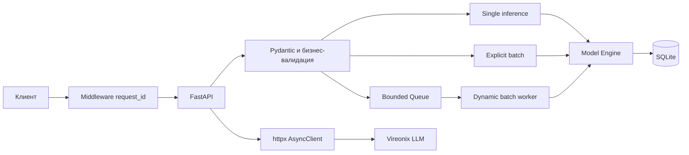
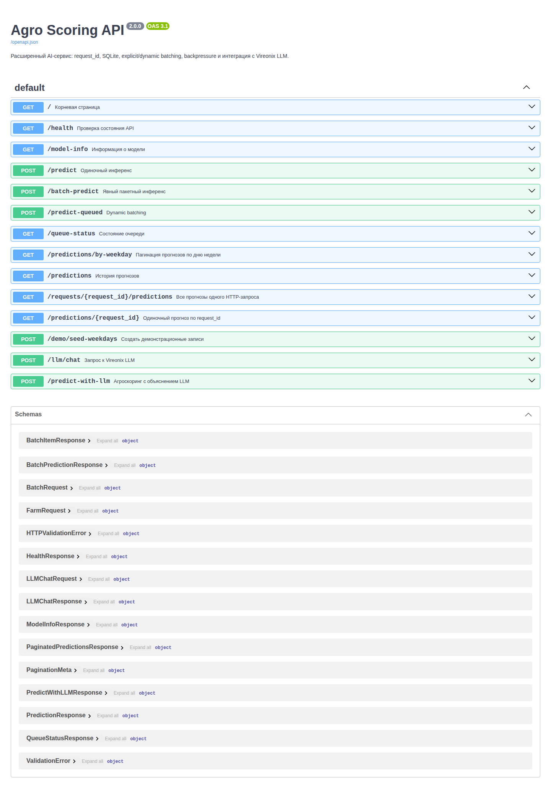
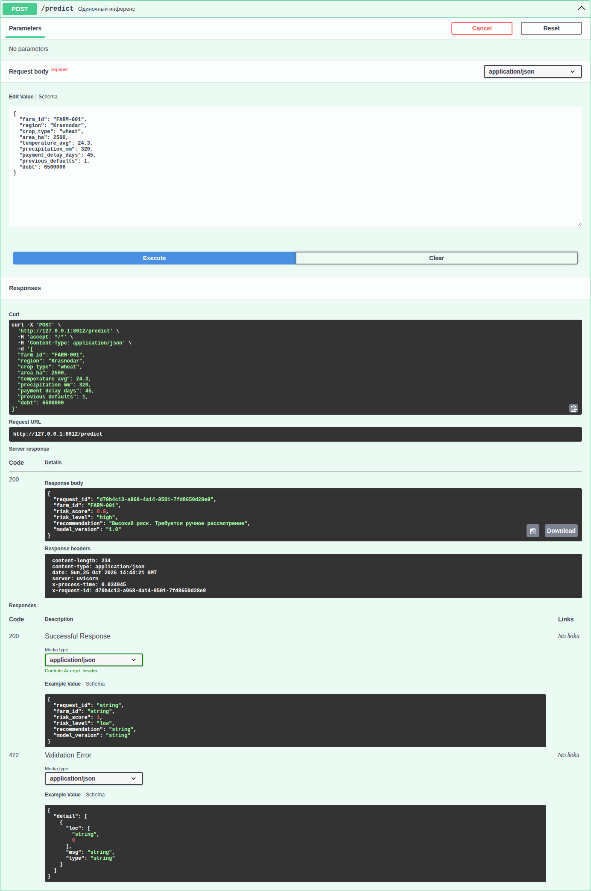
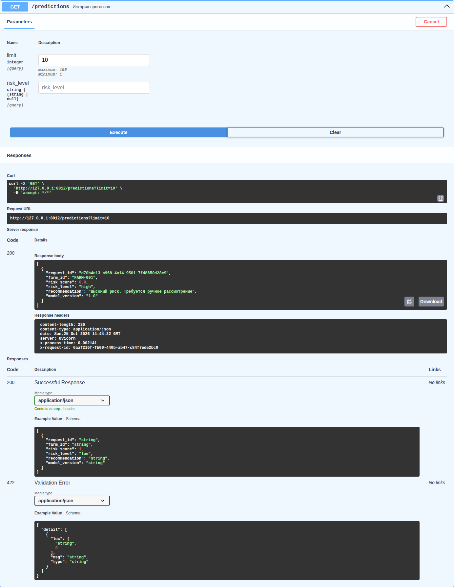
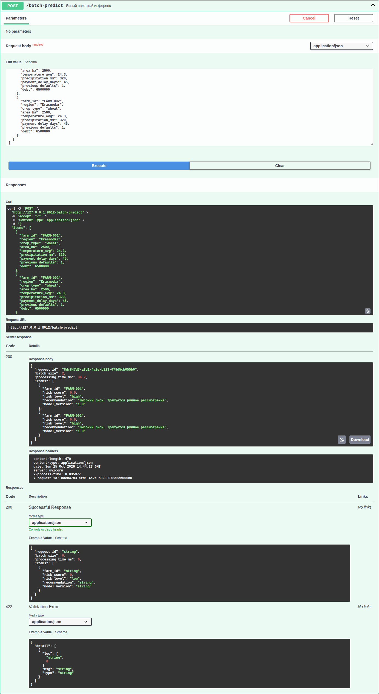
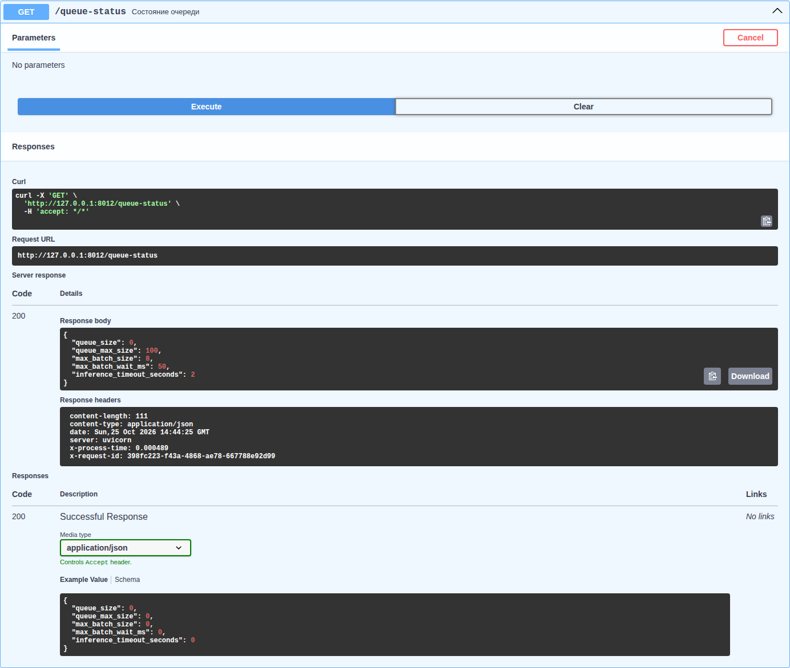
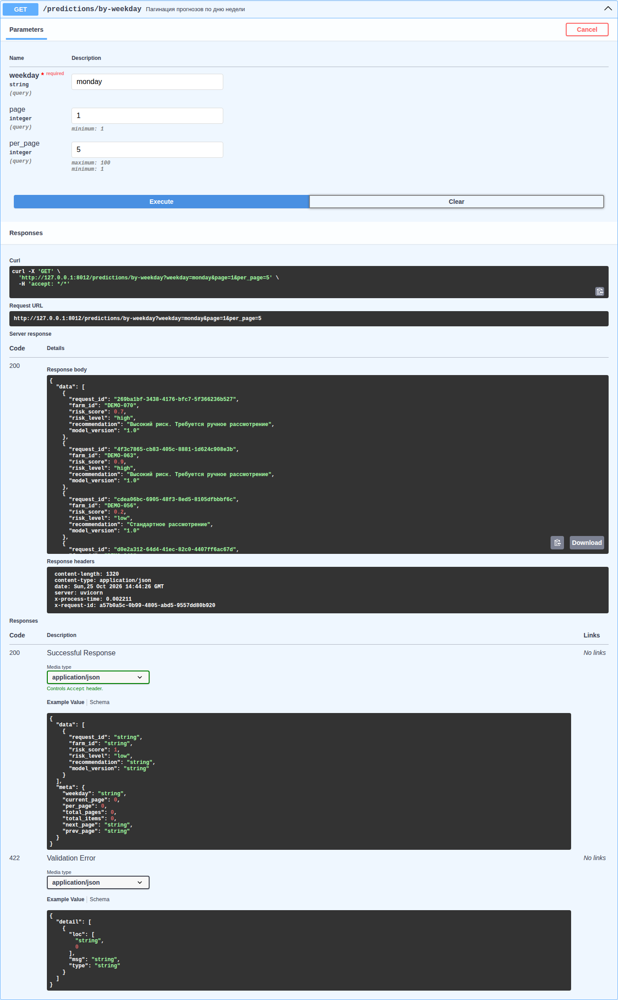
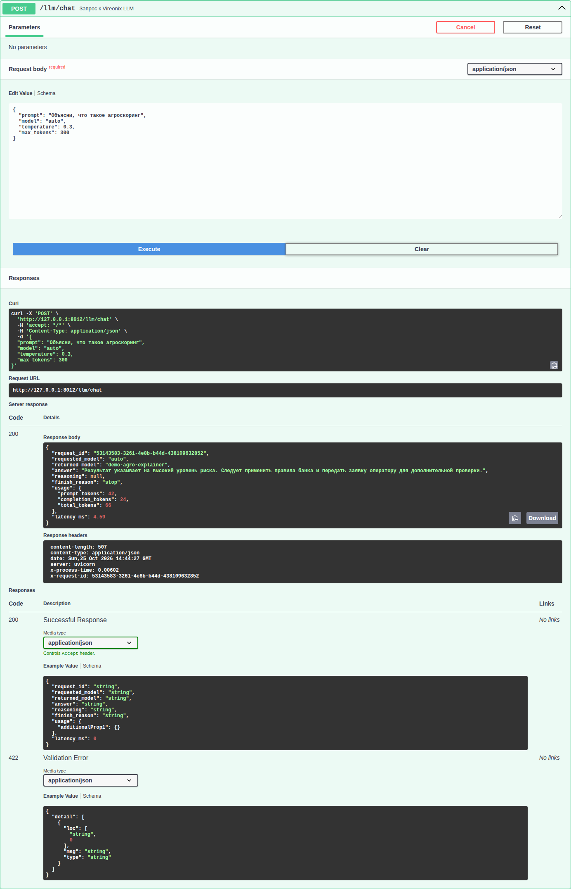
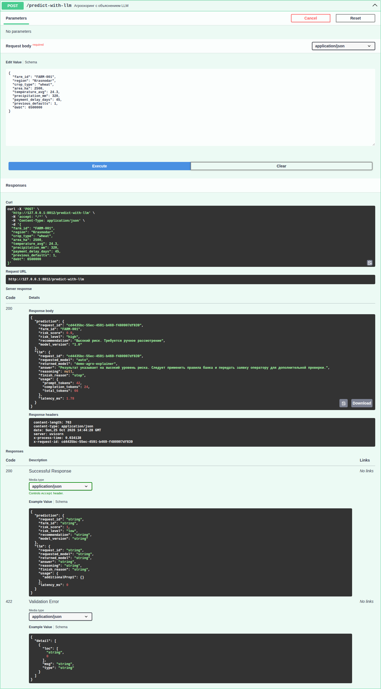

# Отчёт по лабораторной работе №2

**Дисциплина:** «Современные интеллектуальные сетевые сервисы»  
**Тема:** «Расширение AI-сервиса: request ID, SQLite, batching и LLM»  
**Выполнил:** студент группы МПИ-25-1-1 Цыканов Артём Эдуардович  
**Проверила:** Корнет Мария Евгеньевна

## 1. Цель работы

Расширить REST API сервиса агроскоринга: обеспечить трассировку запросов,
асинхронное хранение результатов, пакетный инференс, backpressure, timeout,
пагинацию и безопасное подключение внешней LLM.

## 2. Архитектура

Middleware принимает клиентский `X-Request-ID` либо генерирует UUID, сохраняет
его в `request.state`, добавляет в логи и возвращает в заголовке ответа. Все
результаты записываются в SQLite через `aiosqlite`. Lifespan создаёт БД, один
HTTP-клиент и batch-worker, а при остановке освобождает ресурсы.

Исходный код решения: [репозиторий на GitHub](https://github.com/Artem216/siss/tree/main/lab_02).

## 3. Реализованный API

| Endpoint | Метод | Назначение |
|---|---|---|
| `/health` | GET | Проверка API |
| `/model-info` | GET | Состояние модели |
| `/predict` | POST | Одиночный инференс и запись в SQLite |
| `/batch-predict` | POST | Explicit batch до 8 объектов |
| `/predict-queued` | POST | Dynamic batching через очередь |
| `/queue-status` | GET | Наблюдаемость очереди |
| `/predictions` | GET | История и фильтрация |
| `/predictions/{request_id}` | GET | Один результат; `409` для batch |
| `/requests/{request_id}/predictions` | GET | Все результаты HTTP batch-запроса |
| `/predictions/by-weekday` | GET | Пагинация по дню недели |
| `/demo/seed-weekdays` | POST | Демонстрационные данные |
| `/llm/chat` | POST | Запрос к OpenAI-совместимой LLM |
| `/predict-with-llm` | POST | Скоринг и текстовое объяснение |

Все ошибки имеют форму `{"detail": ..., "request_id": ...}`. Реализованы
статусы `400`, `404`, `409`, `422`, `429`, `500`, `502`, `503` и `504`.

## 4. Результаты работы

### Swagger UI

### Одиночный прогноз и чтение SQLite

### Explicit и dynamic batching

### Пагинация

### Интеграция LLM

Приложение по умолчанию обращается к `https://vireonix.ai/v1`. Во время
подготовки отчёта провайдер отвечал `502` с сообщением о временной
недоступности. Поэтому успешные скриншоты LLM получены через локальный
OpenAI-совместимый демонстрационный провайдер; обработка ошибок реального
провайдера также проверена автоматически.

В `/predict-with-llm` сначала выполняется детерминированный скоринг. Во внешний
сервис передаются только `risk_score`, `risk_level`, рекомендация и версия
модели — без `farm_id` и исходных финансовых признаков. LLM не может изменить
результат скоринга.

## 5. Таблица тест-кейсов

| № | Запрос | Ожидаемый код | Полученный код | Результат |
|---:|---|---:|---:|---|
| 1 | `GET /health` | 200 | 200 | Пройден |
| 2 | корректный `POST /predict` | 200 | 200 | Пройден |
| 3 | `area_ha = -100` | 422 | 422 | Пройден |
| 4 | неизвестный регион | 400 | 400 | Пройден |
| 5 | существующий `request_id` | 200 | 200 | Пройден |
| 6 | неизвестный `request_id` | 404 | 404 | Пройден |
| 7 | корректный `POST /batch-predict` | 200 | 200 | Пройден |
| 8 | batch больше `MAX_BATCH_SIZE` | 422 | 422 | Пройден |
| 9 | `POST /predict-queued` | 200 | 200 | Пройден |
| 10 | переполненная очередь | 429 | 429 | Пройден |
| 11 | пагинация `page=1&per_page=5` | 200 | 200 | Пройден |
| 12 | `page=-1` | 422 | 422 | Пройден |
| 13 | неизвестный weekday | 400 | 400 | Пройден |
| 14 | корректный `POST /llm/chat` | 200 | 200 | Пройден |
| 15 | ошибка LLM-провайдера | 502/503/504 | 502/503/504 | Пройден |
| 16 | корректный `POST /predict-with-llm` | 200 | 200 | Пройден |

Всего выполнено 28 автоматических тестов. Дополнительно проверены параллельные
queued-запросы, `409` для batch request ID, порядок и фильтрация истории,
сквозной request ID, заголовок времени, `500`, недоступность модели, timeout,
структура OpenAPI и отсутствие конфиденциальных данных в LLM-промпте.

## 6. API-контракт

| Endpoint | Method | Input | Output | Success | Ошибки |
|---|---|---|---|---:|---|
| `/health` | GET | — | `HealthResponse` | 200 | 500 |
| `/predict` | POST | `FarmRequest` | `PredictionResponse` | 200 | 400, 422, 503, 504 |
| `/batch-predict` | POST | `BatchRequest` | `BatchPredictionResponse` | 200 | 400, 422, 503, 504 |
| `/predict-queued` | POST | `FarmRequest` | `PredictionResponse` | 200 | 400, 422, 429, 503, 504 |
| `/predictions` | GET | query | `PredictionResponse[]` | 200 | 400, 422, 503 |
| `/predictions/by-weekday` | GET | weekday, page, per_page | paginated response | 200 | 400, 404, 422, 503 |
| `/llm/chat` | POST | `LLMChatRequest` | `LLMChatResponse` | 200 | 422, 502, 503, 504 |
| `/predict-with-llm` | POST | `FarmRequest` | `PredictWithLLMResponse` | 200 | 400, 422, 502, 503, 504 |

## 7. Ответы на вопросы

Блокирующий `sqlite3.execute()` внутри асинхронного endpoint занимает поток
event loop до завершения операции. В это время тот же worker не может
обрабатывать другие соединения. `aiosqlite` переносит блокирующую работу и
позволяет ожидать её через `await`.

Один `executemany()` с одним `COMMIT` предпочтительнее восьми отдельных
`INSERT + COMMIT`: уменьшается число дисковых синхронизаций и переключений,
растёт throughput, а весь batch сохраняется атомарно.

Неограниченная очередь при перегрузке будет расти быстрее, чем модель успевает
обрабатывать запросы. Это ведёт к неограниченному расходу памяти, увеличению
latency и возможному падению процесса. Ограниченная очередь создаёт
backpressure и быстро возвращает клиенту `429`.

## 8. Вывод

Сервис дополнен средствами, необходимыми реальному AI-приложению: трассировкой,
постоянным асинхронным хранилищем, управлением нагрузкой, пакетным инференсом,
timeout и наблюдаемостью. Детерминированный скоринг отделён от LLM: модель
рассчитывает риск, а LLM формирует только поясняющий текст. Такое разделение
сохраняет воспроизводимость решения и уменьшает риск утечки данных.

